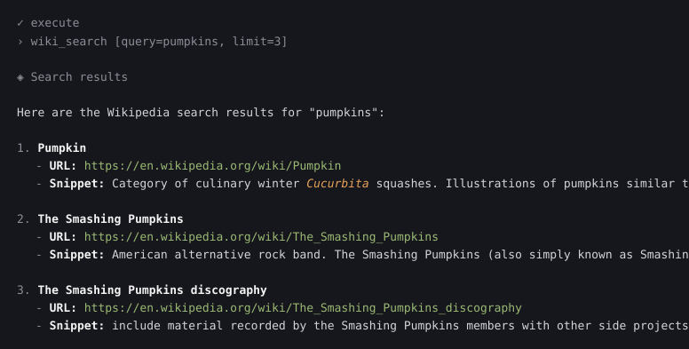

# opencode-search

An [OpenCode](https://opencode.ai) plugin that gives your agent access to Firecrawl web search, Google News, Wikipedia, Bluesky, standard.site, MDN Web Docs, the AWS documentation, and the IETF, W3C and WHATWG specifications.



## What this adds over OpenCode's built-in tools

Ten search tools that work without an API key or an account. OpenCode 1 has no web search at all unless you use its own provider, and OpenCode 2's requires a key for Exa, Firecrawl, Parallel or Tavily.

One is general web search: Firecrawl, through its keyless API, which is free up to a daily limit per IP address.

The other nine search sources a general web search does not reach: Bluesky posts and standard.site articles through the AT Protocol, Wikipedia, MDN and the AWS documentation through their own search APIs, Google News for what is being published now, and the IETF, W3C and WHATWG specification indexes directly.

Google web search, DuckDuckGo, Brave and Mojeek were removed — see [REMOVED.md](REMOVED.md) for what was tested and why.

## Quick Start

### OpenCode 2

Add to your `opencode.json`:

```json
{
  "plugins": ["opencode-search"]
}
```

Restart OpenCode. The plugin will be installed automatically.

### OpenCode 1

```json
{
  "plugin": ["opencode-search@0.0.9"]
}
```

**0.0.9 is the last release for OpenCode 1 and will not be updated.** New providers and fixes land on 1.x, which requires OpenCode 2. Pin the version rather than tracking latest.

## Tools

### aws_docs_search

Search the AWS documentation on `docs.aws.amazon.com`. Returns page title, URL and summary.

| Parameter | Type   | Required | Description                    |
| --------- | ------ | -------- | ------------------------------ |
| `query`   | string | yes      |                                |
| `limit`   | number | no       | Number of results (default 10) |

Uses the search service behind the AWS documentation site, the same one AWS's own [documentation MCP server](https://github.com/awslabs/mcp/tree/main/src/aws-documentation-mcp-server) calls. It needs no key.

### firecrawl_search

Search the web with [Firecrawl](https://docs.firecrawl.dev/features/search). Returns title, URL and snippet.

| Parameter | Type   | Required | Description                    |
| --------- | ------ | -------- | ------------------------------ |
| `query`   | string | yes      |                                |
| `limit`   | number | no       | Number of results (default 10) |

Firecrawl answers search without an API key, up to a daily limit per IP address. Past that limit the tool reports Firecrawl's error rather than empty results.

### gnews_search

Search Google News for recent articles. Returns headline, publisher, and publication date.

| Parameter | Type   | Required |
| --------- | ------ | -------- |
| `query`   | string | yes      |

**News and tech media only — not general web search, and not documentation.** It queries the Google News RSS feed, which is a different service from Google web search and still answers plain HTTP requests. Links are `news.google.com` redirect URLs rather than publisher URLs; they resolve only in a browser, so they are reported as-is.

### bsky_search

Search Bluesky posts via the AT Protocol. Returns posts with author handle, text, and engagement counts (likes, reposts, replies).

| Parameter | Type   | Required | Description                   |
| --------- | ------ | -------- | ----------------------------- |
| `query`   | string | yes      |                               |
| `limit`   | number | no       | Number of results to return   |
| `sort`    | string | no       | Sort order: `top` or `latest` |

### wiki_search

Search Wikipedia articles using the MediaWiki REST API. Returns structured results with title, description, excerpt, and a direct link to the article. No API key required.

| Parameter | Type   | Required | Description               |
| --------- | ------ | -------- | ------------------------- |
| `query`   | string | yes      |                           |
| `limit`   | number | no       | Number of results (1-100) |

### mdn_search

Search MDN Web Docs. Returns documentation pages for web technologies with title, URL, and summary. No API key required.

| Parameter | Type   | Required | Description                 |
| --------- | ------ | -------- | --------------------------- |
| `query`   | string | yes      |                             |
| `limit`   | number | no       | Number of results to return |
| `page`    | number | no       | Page number for pagination  |

### rfc_search

Search IETF RFCs by title via the [Datatracker API](https://datatracker.ietf.org/api/). Returns RFC number, title, date, and abstract. No API key required.

| Parameter | Type   | Required | Description                    |
| --------- | ------ | -------- | ------------------------------ |
| `query`   | string | yes      |                                |
| `limit`   | number | no       | Number of results (default 20) |

Matches on title only, so a query is a phrase from the RFC's name rather than its body.

### standard_search

Search long-form posts published on the AT Protocol: [standard.site](https://standard.site) documents and blogs on Leaflet, pckt, WhiteWind and similar platforms. Returns title, URL, date and snippet.

| Parameter | Type   | Required | Description                                |
| --------- | ------ | -------- | ------------------------------------------ |
| `query`   | string | yes      |                                            |
| `limit`   | number | no       | Number of results (default 20, at most 40) |
| `offset`  | number | no       | Number of results to skip                  |

Queries [pub-search](https://pub-search.waow.tech/), an open-source index of AT Protocol publishing platforms that standard.site's docs list under indexes and discovery. It needs no key. It is a third-party service, so it can change or go away, as the previous appview did.

### w3c_search

Search W3C specifications by title via the [W3C API](https://api.w3.org/). Returns the spec title and URL. No API key required.

| Parameter | Type   | Required | Description                    |
| --------- | ------ | -------- | ------------------------------ |
| `query`   | string | yes      |                                |
| `limit`   | number | no       | Number of results (default 20) |

The W3C API accepts a `q` parameter and ignores it — a real query and a nonsense string both return all 1713 specifications. So the full index is fetched, two pages of 1000, and filtered here. Titles only; the API exposes no abstracts.

### whatwg_search

Search WHATWG living standards. Returns the standard name, URL, and description. No API key required.

| Parameter | Type   | Required | Description                    |
| --------- | ------ | -------- | ------------------------------ |
| `query`   | string | yes      |                                |
| `limit`   | number | no       | Number of results (default 20) |

WHATWG publishes its whole index as one small JSON file and offers no search endpoint, so matching happens here across names and descriptions. There are only 27 standards, so expect few results.
